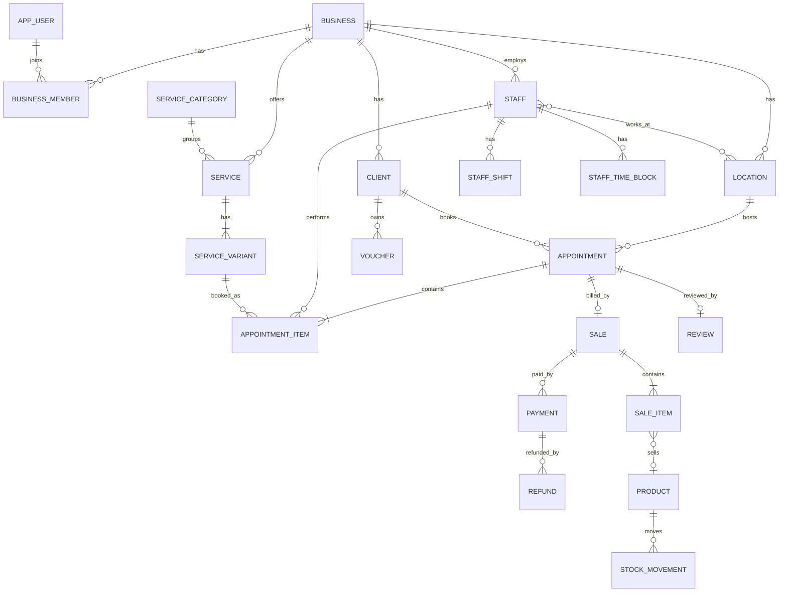

# Booking Platform per Saloni/Spa — Specifica Modello Dati

> Documento di riferimento per Claude Code. Descrive dominio, modello dati PostgreSQL, regole di business e piano di implementazione di una piattaforma SaaS multi-tenant di gestione appuntamenti, clienti, vendite e pagamenti per attività di beauty & wellness (parrucchieri, centri estetici, barbieri, spa).

## 0. Come lavorare (istruzioni per Claude Code)

1. **Prima di scrivere codice**, leggi tutto il documento e proponi un piano per la **Fase 0 e Fase 1** (sezione 9). Attendi conferma.
2. Lavora **una fase alla volta**. Ogni fase deve chiudersi con: migrazioni Flyway, entità/repository, service, controller REST, test (unit + integration con Testcontainers), OpenAPI aggiornato.
3. Il DDL qui sotto è **pseudo-SQL di riferimento**: genera migrazioni Flyway reali, con indici e vincoli coerenti. Se trovi incongruenze o scelte migliori, **segnalale prima di deviare**.
4. Non copiare asset, testi, loghi, nomi commerciali o UI di prodotti esistenti. Il prodotto ha brand e design propri. Le funzionalità sono implementate da specifica funzionale, non da analisi di software di terzi.
5. Codice e identificatori in **inglese**; commenti e documentazione possono essere in italiano.

## 1. Stack e convenzioni

| Area | Scelta |
|---|---|
| Backend | Java 21, Spring Boot 3.x, Spring Web, Spring Data JPA (Hibernate), Spring Security (JWT / OAuth2 resource server), Bean Validation |
| Architettura | **Monolite modulare** (package per bounded context, dipendenze unidirezionali; valutare Spring Modulith) |
| DB | PostgreSQL 16+, migrazioni **Flyway**, test con **Testcontainers** |
| API | REST + OpenAPI (springdoc), errori in formato RFC 7807 (`ProblemDetail`) |
| Frontend | React + TypeScript + Vite + TanStack Query *(sostituibile con Angular: modello dati e API non cambiano)* |
| Build | Maven o Gradle, Docker Compose per dev (postgres, mailhog) |

### Convenzioni DB

> ✅ **Approvato (2026-11-02) — Single-tenant.** L'applicazione serve **un solo salone con una sola sede**. Nessun `business_id`, nessun filtro tenant, nessuna tabella `location`. Un nuovo salone = nuova installazione con DB separato. Nessun dato specifico del salone (nome, brand, orari, fuso, regole) nel codice: tutto in `salon_settings`. Le sezioni successive non ancora revisionate possono contenere ancora riferimenti a `business_id`/`location_id`: vanno ignorati.

- **PK**: `uuid` **v7** generato da Hibernate (`@UuidGenerator(style = VERSION_7)`), default DB `gen_random_uuid()` come fallback; in Java `UUID`.
- **Tempo**: sempre `timestamptz` (UTC). Il fuso IANA del salone è in `salon_settings.timezone`; conversione solo ai bordi (API/UI). Attenzione ai cambi DST nel calcolo slot.
- **Denaro**: `bigint` in **unità minori** (centesimi) + valuta in `salon_settings.currency` (ISO 4217). Mai `float/double`.
- **Enum**: `text` + `CHECK` (non enum nativi Postgres), `@Enumerated(EnumType.STRING)` in JPA.
- **Colonne standard `[std]`** (omesse nel DDL sotto per brevità, da includere in ogni tabella):
  `id uuid PK`, `created_at timestamptz NOT NULL DEFAULT now()`, `updated_at timestamptz NOT NULL DEFAULT now()`, `version bigint NOT NULL DEFAULT 0` (optimistic locking). `created_at`/`updated_at` valorizzati da Hibernate.
- **Soft delete** (`deleted_at timestamptz`) solo su client, service, product, staff; gli indici univoci diventano parziali `WHERE deleted_at IS NULL`.
- **Nessun `created_by`/`updated_by` generico**: le operazioni sensibili vanno in `audit_log`.
- **Snapshot**: righe di appuntamento e vendita copiano nome/prezzo/IVA al momento della creazione (il listino può cambiare, lo storico no).
- **Privacy (UK GDPR + PECR per il marketing)**: consensi espliciti e datati, esportazione e cancellazione/anonimizzazione dati cliente, retention definita, nessun dato sanitario in chiaro nelle note senza base giuridica.

## 2. Mappa dei moduli

```
identity     → app_user, business_member, auth
tenancy      → business, location, opening hours
staff        → staff, shifts, time blocks
catalog      → category, service, variant, tax rate, resource
clients      → client, tags, consents, notes
booking      → appointment, items, availability engine
sales        → sale, items, payments, refunds, numbering
inventory    → product, supplier, stock movements
loyalty      → voucher, package/membership (Fase 3+)
notifications→ templates, log, outbox
reviews      → review (Fase 3+)
platform     → audit_log, outbox_event, idempotency_key
```

## 3. Diagramma ER (semplificato)



## 4. DDL di riferimento

### 4.1 Estensioni

```sql
CREATE EXTENSION IF NOT EXISTS btree_gist;  -- exclusion constraint su uuid + range
CREATE EXTENSION IF NOT EXISTS citext;      -- email case-insensitive
CREATE EXTENSION IF NOT EXISTS pg_trgm;     -- ricerca clienti per nome/telefono
```

### 4.2 Identità e tenancy

```sql
-- ✅ Approvato (2026-11-02)
-- [std] Account di accesso per tutti (personale e clienti): solo credenziali.
-- I dati anagrafici stanno in client (clienti) e staff (collaboratori), perché il salone
-- registra anche clienti senza account (walk-in).
CREATE TABLE app_user (
  email              citext NOT NULL UNIQUE,
  password_hash      text,                -- null se registrato solo con Google
  role               text NOT NULL CHECK (role IN ('ADMIN','RECEPTION','STAFF','CLIENT')),
  status             text NOT NULL DEFAULT 'ACTIVE' CHECK (status IN ('ACTIVE','DISABLED')),
  email_verified_at  timestamptz,         -- null = non può accedere finché non conferma
  last_login_at      timestamptz
);

-- ✅ Approvato (2026-11-02)
-- [std] Login federato (per ora solo Google, via Spring Security OAuth2/OIDC)
CREATE TABLE user_identity (
  user_id           uuid NOT NULL REFERENCES app_user(id) ON DELETE CASCADE,
  provider          text NOT NULL CHECK (provider IN ('GOOGLE')),
  provider_subject  text NOT NULL,        -- id univoco dell'utente presso il provider
  UNIQUE (provider, provider_subject)
);

-- ✅ Approvato (2026-11-02)
-- [std] Token monouso: conferma email, reset password (anche per la prima password dei collaboratori)
CREATE TABLE user_token (
  user_id     uuid NOT NULL REFERENCES app_user(id) ON DELETE CASCADE,
  type        text NOT NULL CHECK (type IN ('EMAIL_VERIFICATION','PASSWORD_RESET')),
  token_hash  text NOT NULL UNIQUE,       -- solo hash, mai il token in chiaro
  expires_at  timestamptz NOT NULL,
  used_at     timestamptz
);

-- ✅ Approvato (2026-11-02; adattato al UK 2026-11-03)
-- [std] Dati e regole del salone: UNA sola riga, creata dalla migrazione; l'admin può solo leggerla/modificarla.
-- Sostituisce business + location. È ciò che si cambia replicando l'app per un altro salone.
CREATE TABLE salon_settings (
  -- Identità
  name                       text NOT NULL,          -- insegna
  legal_name                 text,
  vat_number                 text,                   -- UK VAT registration number (NULL se non registrato)
  company_number             text,                   -- Companies House (se società)
  -- Contatti e indirizzo
  address_line               text,
  city                       text,
  postal_code                text,                   -- UK postcode, es. SW1A 1AA
  county                     text,
  phone                      text,
  email                      text,
  -- Localizzazione
  timezone                   text NOT NULL DEFAULT 'Europe/London',
  currency                   char(3) NOT NULL DEFAULT 'GBP',
  -- Regole di prenotazione online
  online_booking_enabled     boolean NOT NULL DEFAULT true,
  slot_interval_minutes      int NOT NULL DEFAULT 15 CHECK (slot_interval_minutes IN (5,10,15,20,30,60)),
                                                     -- passo degli orari di inizio proposti, NON la durata
  min_notice_minutes         int NOT NULL DEFAULT 60,   -- anticipo minimo per prenotare
  max_advance_days           int NOT NULL DEFAULT 90,   -- orizzonte prenotabile
  cancellation_window_hours  int NOT NULL DEFAULT 24,   -- disdetta più tardi = tardiva
  -- Anti no-show
  max_open_online_bookings   int NOT NULL DEFAULT 2,    -- appuntamenti futuri prenotabili online per cliente
  no_show_block_threshold    int NOT NULL DEFAULT 3,    -- dopo N assenze niente prenotazione online
  -- Pagamenti online (Stripe) e acconto (2026-11-03)
  online_payments_enabled    boolean NOT NULL DEFAULT false,
  deposit_percent_bp         int NOT NULL DEFAULT 1000, -- 10%; rimborsato se disdetta entro cancellation_window_hours
  -- Notifiche (2026-11-03)
  reminder_hours_before      int NOT NULL DEFAULT 24,
  notification_email         text,                      -- avvisi al salone (NULL = email)
  -- Recensioni Google (2026-11-03)
  google_review_url          text,                      -- link per lasciare una recensione
  google_place_id            text                       -- per leggere voto medio e recensioni (Places API)
);

-- ❌ business_member eliminata (single-tenant): il ruolo è su app_user.
--    Ruoli: ADMIN (tutto, statistiche, impostazioni), RECEPTION (agenda di tutti, clienti, cassa;
--    no statistiche/impostazioni), STAFF (solo la propria agenda), CLIENT (prenotazione online).
-- Regole registrazione clienti:
--  - classica (form + conferma email) o Google; nome, cognome, email, telefono obbligatori:
--    dopo il login Google si chiede subito il telefono mancante (completamento profilo).
--  - se l'email coincide con un client già in anagrafica, l'account viene collegato a quella scheda.
--  - telefono verificato con codice OTP via WhatsApp, fallback SMS, tramite provider esterno
--    (es. Twilio Verify): nessuna tabella OTP nel nostro DB, solo client.phone_verified_at.

-- ✅ Approvato (2026-11-02)
-- [std] Fasce di apertura settimanali, senza vincoli: più fasce per giorno, 24h, giorni senza righe = chiuso.
-- Minuti dall'inizio del giorno (0..1440) per poter esprimere "fino alle 24:00" (LocalTime non lo supporta).
-- Apertura a cavallo della mezzanotte = due righe consecutive (es. ven 1320-1440 + sab 0-120);
-- il motore di disponibilità unisce le fasce contigue. Il backend rifiuta fasce sovrapposte nello stesso giorno.
CREATE TABLE opening_hours (
  weekday        smallint NOT NULL CHECK (weekday BETWEEN 1 AND 7),   -- ISO: 1 = lunedì
  opens_minute   int NOT NULL CHECK (opens_minute BETWEEN 0 AND 1439),
  closes_minute  int NOT NULL CHECK (closes_minute BETWEEN 1 AND 1440),
  CHECK (closes_minute > opens_minute)
);

-- ✅ Approvato (2026-11-02)
-- [std] Eccezioni agli orari settimanali su intervalli liberi (ore, mezze giornate, settimane).
-- CLOSED = chiusura straordinaria, OPEN = apertura straordinaria. In caso di sovrapposizione vince CLOSED.
CREATE TABLE schedule_exception (
  type       text NOT NULL CHECK (type IN ('CLOSED','OPEN')),
  starts_at  timestamptz NOT NULL,
  ends_at    timestamptz NOT NULL,
  reason     text,
  CHECK (ends_at > starts_at)
);
```

### 4.3 Staff

```sql
-- ✅ Approvato (2026-11-02) — niente provvigioni automatiche (premi decisi dal titolare fuori dal sistema)
-- [std] Collaboratore (può esistere anche senza account di accesso)
CREATE TABLE staff (
  user_id         uuid UNIQUE REFERENCES app_user(id),  -- facoltativo: solo se accede al gestionale
  first_name      text NOT NULL,
  last_name       text,
  display_name    text NOT NULL,             -- nome mostrato ai clienti
  phone           text,
  job_title       text,
  calendar_color  char(7),                   -- colonna in agenda, es. #FF8800
  bookable_online boolean NOT NULL DEFAULT true,  -- false = prenotabile solo dal salone
  sort_order      int NOT NULL DEFAULT 0,    -- ordine colonne in agenda
  deleted_at      timestamptz                -- ex collaboratore: fuori dall'agenda, storico intatto
);

-- ✅ Approvato (2026-11-02)
-- [std] Turno di lavoro in una data precisa: UNICA fonte per la disponibilità del collaboratore.
-- Turni completamente liberi (l'admin li inserisce per l'orizzonte che conosce; oltre = non prenotabile).
-- Ridurre un turno non cancella gli appuntamenti: in agenda vengono mostrati come "fuori turno".
CREATE TABLE staff_shift (
  staff_id   uuid NOT NULL REFERENCES staff(id) ON DELETE CASCADE,
  starts_at  timestamptz NOT NULL,
  ends_at    timestamptz NOT NULL,
  CHECK (ends_at > starts_at)
);

-- ✅ Approvato (2026-11-02)
-- [std] Indisponibilità puntuali con motivo (anche dentro un turno, per le statistiche: es. giorni di malattia)
CREATE TABLE staff_time_block (
  staff_id   uuid NOT NULL REFERENCES staff(id) ON DELETE CASCADE,
  type       text NOT NULL CHECK (type IN ('TIME_OFF','SICK','BREAK','TRAINING','OTHER')),
  starts_at  timestamptz NOT NULL,
  ends_at    timestamptz NOT NULL,
  reason     text,
  CHECK (ends_at > starts_at)
);

-- ✅ Approvato (2026-11-02)
-- [std] Turni modello (es. "Mattina 9-13") da applicare a più celle della griglia settimanale
CREATE TABLE shift_template (
  name           text NOT NULL,
  starts_minute  int NOT NULL CHECK (starts_minute BETWEEN 0 AND 1439),
  ends_minute    int NOT NULL CHECK (ends_minute BETWEEN 1 AND 1440),
  CHECK (ends_minute > starts_minute)
);

-- ✅ Approvato (2026-11-02)
-- [std] Settimana tipo del collaboratore: serve SOLO a generare staff_shift, non è letta dal motore di disponibilità.
-- Modificarla non tocca i turni già generati.
CREATE TABLE staff_week_pattern (
  staff_id       uuid NOT NULL REFERENCES staff(id) ON DELETE CASCADE,
  weekday        smallint NOT NULL CHECK (weekday BETWEEN 1 AND 7),
  starts_minute  int NOT NULL CHECK (starts_minute BETWEEN 0 AND 1439),
  ends_minute    int NOT NULL CHECK (ends_minute BETWEEN 1 AND 1440),
  CHECK (ends_minute > starts_minute)
);
```

**Strumenti admin per i turni** (operazioni, nessuna tabella aggiuntiva):
- **Copia settimana** su N settimane o fino a una data, per tutti o alcuni collaboratori; settimane di destinazione già compilate: sovrascrivi o salta. Giorni con `schedule_exception` CLOSED saltati. Copia in **ora locale** (le 9:00 restano 9:00 anche al cambio DST). Anteprima/riepilogo prima di confermare.
- **Applica settimana tipo** (`staff_week_pattern`) per N settimane, stesse regole della copia.
- **Applica preset** (`shift_template`) a più celle selezionate (giorni × collaboratori).
- **Cancellazione in blocco** di un intervallo; modifica rapida trascinando i bordi del turno in agenda.

**Prenotabilità di un collaboratore** = turno presente ∩ salone aperto (`opening_hours` + `schedule_exception`) − `staff_time_block` − appuntamenti esistenti.


### 4.4 Catalogo servizi

> Esempio: balayage 50 min / 100 € + taglio 20 min / 80 € + piega 10 min / 20 € = 80 min / 200 €.
> Servizi cumulabili: durata e prezzo si sommano nell'ordine di scelta (l'admin può riordinare). Tutto configurato dall'admin.

```sql
-- ✅ Approvato (2026-11-03)
-- [std]
CREATE TABLE service_category (
  name        text NOT NULL,                     -- es. "Colore", "Taglio", "Piega"
  sort_order  int NOT NULL DEFAULT 0
);

-- [std]
CREATE TABLE service (
  category_id       uuid REFERENCES service_category(id),
  name              text NOT NULL,
  description       text,
  duration_minutes  int NOT NULL CHECK (duration_minutes > 0),
  price_minor       bigint NOT NULL CHECK (price_minor >= 0),   -- IVA inclusa
  price_type        text NOT NULL DEFAULT 'FIXED' CHECK (price_type IN ('FIXED','FROM')),
  vat_rate_bp       int NOT NULL DEFAULT 2000,   -- UK standard 20%; 0 se il salone non è registrato IVA
  online_bookable   boolean NOT NULL DEFAULT true,
  deposit_required  boolean NOT NULL DEFAULT false,  -- acconto obbligatorio online (2026-11-03)
  sort_order        int NOT NULL DEFAULT 0,
  deleted_at        timestamptz
);

-- Chi può eseguire quale servizio, con prezzo/durata facoltativi diversi dallo standard
CREATE TABLE service_staff (
  service_id                uuid NOT NULL REFERENCES service(id) ON DELETE CASCADE,
  staff_id                  uuid NOT NULL REFERENCES staff(id) ON DELETE CASCADE,
  price_override_minor      bigint CHECK (price_override_minor >= 0),        -- NULL = prezzo del servizio
  duration_override_minutes int CHECK (duration_override_minutes > 0),       -- NULL = durata del servizio
  PRIMARY KEY (service_id, staff_id)
);
```

Tolti rispetto all'originale: `tax_rate` (IVA sul servizio), campi acconto originali (sostituiti da `deposit_required` + `salon_settings.deposit_percent_bp`), price_type `FREE` (basta prezzo 0), `service_location` (sede unica), `resource`/`service_resource` (solo se le attrezzature diventano un collo di bottiglia).

Decisioni (2026-11-03):
- Niente varianti: versioni diverse = servizi distinti (es. "Taglio corti", "Taglio lunghi").
- Niente tempo di posa nel modello: il collaboratore è occupato per tutta la durata. Se durante la posa si vuole
  inserire un altro lavoro, lo fa l'admin sovrapponendo gli appuntamenti (sovrapposizione solo da ADMIN).
- Prezzo/durata per collaboratore: override facoltativi su `service_staff` (NULL = valore del servizio).

### 4.5 Clienti

```sql
-- ✅ Approvato (2026-11-03)
-- [std] Provenienza del cliente, lista gestita dall'admin (es. "Passaparola", "Instagram", "Online")
CREATE TABLE client_source (
  name        text NOT NULL UNIQUE,
  sort_order  int NOT NULL DEFAULT 0
);

-- [std] Scheda cliente: esiste anche senza account (walk-in, clienti al telefono).
CREATE TABLE client (
  user_id                       uuid UNIQUE REFERENCES app_user(id),  -- se il cliente si è registrato online
  first_name                    text NOT NULL,
  last_name                     text,                  -- obbligatorio solo nella registrazione online
  email                         citext,
  phone                         text,                  -- formato E.164, es. +393331234567; NON unico (mamma e figlia)
  phone_verified_at             timestamptz,           -- OTP WhatsApp/SMS (già deciso con app_user)
  birth_date                    date,
  notes                         text,                  -- un solo campo modificabile, niente storico
  source_id                     uuid REFERENCES client_source(id),
  nationality                   char(2),               -- ISO 3166-1 alpha-2; 'IT' = messaggi in italiano, altrimenti inglese
  marketing_email_consent_at    timestamptz,           -- NULL = nessun consenso
  marketing_sms_consent_at      timestamptz,
  marketing_whatsapp_consent_at timestamptz,
  online_booking_blocked_at     timestamptz,           -- NULL = può prenotare online
  deleted_at                    timestamptz
);
CREATE UNIQUE INDEX ux_client_email ON client (email) WHERE email IS NOT NULL AND deleted_at IS NULL;
CREATE INDEX ix_client_search ON client USING gin
  ((coalesce(first_name,'')||' '||coalesce(last_name,'')||' '||coalesce(phone,'')) gin_trgm_ops);

-- [std] Etichette gestite dall'admin (es. "VIP", "Sposa 2027")
CREATE TABLE client_tag (
  name  text NOT NULL UNIQUE
);
CREATE TABLE client_tag_assignment (
  client_id  uuid NOT NULL REFERENCES client(id) ON DELETE CASCADE,
  tag_id     uuid NOT NULL REFERENCES client_tag(id) ON DELETE CASCADE,
  PRIMARY KEY (client_id, tag_id)
);
```

Blocco no-show: le assenze si contano dagli appuntamenti (stato NO_SHOW), niente contatore duplicato. Quando un'assenza
fa raggiungere `salon_settings.no_show_block_threshold`, il sistema imposta `online_booking_blocked_at`; l'admin
può bloccare/sbloccare a mano. Tolti rispetto all'originale: `no_show_count`, `client_note` (niente storico note).

Decisioni (2026-11-03): etichette sì; un solo campo note, niente storico; consensi marketing per email/SMS/WhatsApp;
telefono non unico (mamma e figlia); provenienza da elenco gestito dall'admin (statistiche pulite).

### 4.6 Prenotazioni (cuore del sistema)

```sql
-- ✅ Approvato (2026-11-03)
-- [std] Appuntamento = contenitore di una o più righe-servizio (es. balayage + taglio + piega)
CREATE TABLE appointment (
  client_id            uuid REFERENCES client(id),     -- NULL = cliente anonimo: lo può creare solo ADMIN
  status               text NOT NULL DEFAULT 'BOOKED'
    CHECK (status IN ('PENDING_PAYMENT','BOOKED','CONFIRMED','COMPLETED','CANCELLED','NO_SHOW')),
                                                       -- PENDING_PAYMENT: in attesa di Stripe, tiene l'orario
                                                       -- pochi minuti dopo created_at, poi scade (CANCELLED)
  confirmed_at         timestamptz,                    -- quando è passato a CONFIRMED
  starts_at            timestamptz NOT NULL,           -- = min(items.starts_at), per l'agenda
  ends_at              timestamptz NOT NULL,           -- = max(items.ends_at)
  client_notes         text,                           -- scritte dal cliente prenotando online
  internal_notes       text,                           -- visibili solo al salone
  created_by_user_id   uuid NOT NULL REFERENCES app_user(id),  -- ruolo CLIENT = prenotazione online
  cancelled_at         timestamptz,
  cancelled_by_user_id uuid REFERENCES app_user(id),
  late_cancellation    boolean NOT NULL DEFAULT false, -- disdetta dentro cancellation_window_hours
  CHECK (ends_at > starts_at)
);
CREATE INDEX ix_appt_calendar ON appointment (starts_at);
CREATE INDEX ix_appt_client ON appointment (client_id, starts_at DESC);

-- [std] Riga-servizio: chi fa cosa e quando
CREATE TABLE appointment_item (
  appointment_id  uuid NOT NULL REFERENCES appointment(id) ON DELETE CASCADE,
  service_id      uuid NOT NULL REFERENCES service(id),
  staff_id        uuid NOT NULL REFERENCES staff(id),
  starts_at       timestamptz NOT NULL,
  ends_at         timestamptz NOT NULL,
  service_name    text NOT NULL,                 -- copia al momento della prenotazione
  price_minor     bigint NOT NULL,               -- copia (con override del collaboratore); il conto vero è nella vendita
  sort_order      int NOT NULL DEFAULT 0,
  blocking        boolean NOT NULL DEFAULT true, -- false quando l'appuntamento passa a CANCELLED/NO_SHOW
  forced_overlap  boolean NOT NULL DEFAULT false,-- true = sovrapposizione inserita da ADMIN
  CHECK (ends_at > starts_at)
);

-- Anti-doppia-prenotazione nel DB: lo stesso collaboratore non può avere due righe sovrapposte,
-- tranne quelle forzate dall'admin. Le righe forzate restano comunque occupate per la prenotazione online.
ALTER TABLE appointment_item ADD CONSTRAINT no_staff_overlap
  EXCLUDE USING gist (staff_id WITH =, tstzrange(starts_at, ends_at, '[)') WITH &&)
  WHERE (blocking AND NOT forced_overlap);
```

Tolti rispetto all'originale: `location_id`, `source` (online = creato da un utente CLIENT), stati intermedi
(`ARRIVED`, `IN_PROGRESS`), `cancelled_by`/`cancellation_reason`, `confirmation_token` (chi prenota online
ha un account), `variant_name`/`discount`/`tax_rate_bp` (sconti e IVA si gestiscono nella vendita),
`resource_id`/`no_resource_overlap`, `appointment_status_history`.

Decisioni (2026-11-03): solo `CONFIRMED` in più; provenienza = basta sapere se online; appuntamento
anonimo (senza cliente) ammesso ma solo da ADMIN; niente storico modifiche; niente motivo disdetta.
Conferma dall'app solo per clienti registrati (`client.user_id` valorizzato), dopo il login: niente `confirmation_token`.
Il promemoria arriva anche ai non registrati con telefono in scheda (deciso con le notifiche); per loro la conferma la
segna il salone. L'appuntamento anonimo è tipicamente un cliente arrivato in salone che non vuole
registrarsi: l'admin lo inserisce solo per le statistiche, senza promemoria né conferma.

### 4.7 Vendite e pagamenti

> Esempio: Maria prenota balayage + taglio + piega (200 £) e paga online l'acconto del 10% (20 £). In salone compra anche
> uno shampoo (25 £): totale 225 £, già pagati 20 £, restano 205 £ (es. 100 £ contanti + 105 £ carta al POS).

```sql
-- ✅ Approvato (2026-11-03)
-- Acconto: salon_settings.online_payments_enabled / deposit_percent_bp, service.deposit_required,
-- appointment.status 'PENDING_PAYMENT'. Rimborso se disdetta prima di cancellation_window_hours, altrimenti no.

-- Numerazione progressiva per anno (riga bloccata con SELECT ... FOR UPDATE: nessun buco)
CREATE TABLE sale_sequence (
  year         int PRIMARY KEY,
  last_number  int NOT NULL DEFAULT 0
);

-- [std] Vendita = il conto. Per un appuntamento si apre alla prenotazione (per registrare l'acconto online).
-- Si può aprire anche senza appuntamento (es. solo un prodotto).
CREATE TABLE sale (
  appointment_id      uuid UNIQUE REFERENCES appointment(id),
  client_id           uuid REFERENCES client(id),
  status              text NOT NULL DEFAULT 'OPEN' CHECK (status IN ('OPEN','COMPLETED','CANCELLED')),
  number              text UNIQUE,              -- assegnato al completamento, es. 2026/000123
  discount_minor      bigint NOT NULL DEFAULT 0 CHECK (discount_minor >= 0),  -- sconto sul totale
  total_minor         bigint NOT NULL DEFAULT 0,  -- calcolato dal server: somma righe - sconto
  completed_at        timestamptz,
  created_by_user_id  uuid REFERENCES app_user(id)   -- NULL se aperta da una prenotazione online
);
-- Correzione di una vendita completata: si toglie/modifica la riga e il totale si ricalcola.

-- [std] Riga della vendita
CREATE TABLE sale_item (
  sale_id              uuid NOT NULL REFERENCES sale(id) ON DELETE CASCADE,
  item_type            text NOT NULL CHECK (item_type IN ('SERVICE','PRODUCT')),
  appointment_item_id  uuid REFERENCES appointment_item(id),
  service_id           uuid REFERENCES service(id),
  product_id           uuid REFERENCES product(id),
  staff_id             uuid REFERENCES staff(id),     -- per le statistiche di rendimento
  description          text NOT NULL,                 -- copia del nome
  quantity             int NOT NULL DEFAULT 1 CHECK (quantity > 0),
  unit_price_minor     bigint NOT NULL CHECK (unit_price_minor >= 0),  -- IVA inclusa
  discount_minor       bigint NOT NULL DEFAULT 0 CHECK (discount_minor >= 0),  -- sconto sulla riga
  vat_rate_bp          int NOT NULL,
  total_minor          bigint NOT NULL,               -- quantity * unit_price - discount
  CHECK ((item_type = 'SERVICE') = (service_id IS NOT NULL)),
  CHECK ((item_type = 'PRODUCT') = (product_id IS NOT NULL))
);

-- [std] Incassi e restituzioni. Saldo = somma PAYMENT riusciti - somma REFUND riusciti.
CREATE TABLE payment (
  sale_id             uuid NOT NULL REFERENCES sale(id),
  kind                text NOT NULL DEFAULT 'PAYMENT' CHECK (kind IN ('PAYMENT','REFUND')),
  method              text NOT NULL CHECK (method IN ('CASH','CARD','ONLINE','BANK_TRANSFER','OTHER')),
                                                      -- CARD = POS in salone; ONLINE = Stripe
  status              text NOT NULL DEFAULT 'SUCCEEDED' CHECK (status IN ('PENDING','SUCCEEDED','FAILED')),
                                                      -- PENDING/FAILED solo per ONLINE
  amount_minor        bigint NOT NULL CHECK (amount_minor > 0),
  stripe_reference    text UNIQUE,                    -- id pagamento/rimborso Stripe (solo ONLINE)
  paid_at             timestamptz,
  created_by_user_id  uuid REFERENCES app_user(id)
);
```

Tolti rispetto all'originale: `location_id`, `subtotal_minor`/`tax_minor` (calcolabili dalle righe), `tip_minor` (niente mance),
stati `VOIDED`/`REFUNDED` (la vendita si corregge), tipi riga `VOUCHER`/`PACKAGE`/`CUSTOM` (buoni: sezione dedicata),
`quantity` decimale, tabella `refund` (i rimborsi sono righe `payment` con `kind = 'REFUND'`).

Pagamento online (Stripe, UK): il cliente paga su pagina Stripe; l'esito arriva al server via webhook (idempotente, mai fidarsi
del browser); rimborso acconto via API Stripe. Correzioni in salone dopo il pagamento: differenza restituita in contanti.

### 4.8 Prodotti e magazzino

```sql
-- ✅ Approvato (2026-11-03) — solo l'elenco dei prodotti in vendita (serve a sale_item)
-- [std]
CREATE TABLE product (
  name         text NOT NULL,
  brand        text,
  price_minor  bigint NOT NULL CHECK (price_minor >= 0),   -- IVA inclusa
  vat_rate_bp  int NOT NULL DEFAULT 2000,
  active       boolean NOT NULL DEFAULT true,
  deleted_at   timestamptz
);
```

> ⏸️ **MAGAZZINO IN SOSPESO (2026-11-03)** — non si sa ancora se il cliente vuole gestirlo. Se sì, si aggiunge sopra
> `product` senza cambiare le tabelle approvate. Domande già pronte: prodotti d'uso interno (tinte, ossigeno) o solo
> rivendita; anagrafica fornitori; costo d'acquisto per il margine; codice a barre; avviso scorta minima; categorie prodotto.
> Riferimento originale (non approvato): `supplier`; su `product` `supplier_id`, `sku`, `barcode`, `cost_minor`,
> `track_stock`, `low_stock_threshold`; `stock_movement` (libro mastro append-only, giacenza = SUM(delta), movimento
> `SALE` per ogni vendita di prodotto e `RETURN` se la riga viene tolta in correzione).

### 4.9 Buoni, notifiche, recensioni, piattaforma

> ⏸️ **BUONI IN SOSPESO (2026-11-03)** — da riprendere se il salone li vorrà. Domande già pronte: importo o servizio;
> uso in più volte (saldo); scadenza; acquisto anche online (Stripe); pacchetti (es. 5 pieghe al prezzo di 4).
> Servirà anche il metodo `VOUCHER` su `payment`. Riferimento originale (non approvato):
>
> ```sql
> -- [std] Buono regalo / credito prepagato (Fase 3)
> CREATE TABLE voucher (
>   code text NOT NULL, client_id uuid REFERENCES client(id),
>   initial_minor bigint NOT NULL, balance_minor bigint NOT NULL CHECK (balance_minor >= 0),
>   expires_at timestamptz, issued_sale_item_id uuid REFERENCES sale_item(id),
>   status text NOT NULL DEFAULT 'ACTIVE' CHECK (status IN ('ACTIVE','EXHAUSTED','EXPIRED','VOIDED')),
>   UNIQUE (business_id, code)
> );
> CREATE TABLE voucher_transaction (  -- [std] ledger append-only
>   voucher_id uuid NOT NULL REFERENCES voucher(id),
>   delta_minor bigint NOT NULL, payment_id uuid REFERENCES payment(id), note text
> );
> ```

#### Notifiche

> Decisioni (2026-11-03): messaggi = prenotazione ricevuta + promemoria + auguri di compleanno; canale per i clienti = WhatsApp;
> lingua del messaggio = dalla nazionalità (italiano per clienti italiani, altrimenti inglese); campagne via email;
> messaggi anche ai clienti non registrati; testi fissi (nel codice, con il nome del salone
> preso da `salon_settings`); avviso al salone via email per nuove prenotazioni/disdette online; campagne promozionali sì.

```sql
-- ✅ Approvato (2026-11-03)
-- Aggiunti anche: client.nationality, salon_settings.reminder_hours_before / notification_email.

-- [std] Campagna promozionale via EMAIL verso i clienti con consenso email, filtrati per etichetta (NULL = tutti)
CREATE TABLE marketing_campaign (
  name        text NOT NULL,
  subject     text NOT NULL,
  body        text NOT NULL,                      -- testo libero scritto dall'admin
  tag_id      uuid REFERENCES client_tag(id),
  sent_at     timestamptz                         -- NULL = bozza
);

-- [std] Registro di ogni messaggio inviato o da inviare (anche gli avvisi al salone)
CREATE TABLE notification_log (
  type                 text NOT NULL CHECK (type IN ('BOOKING_CONFIRMATION','REMINDER','BIRTHDAY','CAMPAIGN',
                                                     'SALON_NEW_BOOKING','SALON_CANCELLATION')),
  channel              text NOT NULL CHECK (channel IN ('WHATSAPP','EMAIL')),
  client_id            uuid REFERENCES client(id),
  appointment_id       uuid REFERENCES appointment(id),
  campaign_id          uuid REFERENCES marketing_campaign(id),
  recipient            text NOT NULL,             -- numero E.164 o indirizzo email
  status               text NOT NULL DEFAULT 'SCHEDULED' CHECK (status IN ('SCHEDULED','SENT','FAILED','SKIPPED')),
  scheduled_for        timestamptz NOT NULL,
  sent_at              timestamptz,
  provider_message_id  text,                      -- id Twilio/email
  error                text
);
CREATE INDEX ix_notif_due ON notification_log (scheduled_for) WHERE status = 'SCHEDULED';
```

Regole: prenotazione ricevuta, promemoria e auguri su WhatsApp a ogni cliente con telefono in scheda (registrato o no).
Prenotazione ricevuta e promemoria sono messaggi di servizio (nessun consenso marketing); auguri solo con consenso
WhatsApp; campagne solo via email e con consenso email. Modelli WhatsApp (en/it) approvati una volta da Meta. Tolta
`notification_template` (testi fissi nel codice, file di messaggi `en`/`it`).

#### Recensioni

> Decisioni (2026-11-03): recensioni sia su Google sia dirette nel gestionale; anche sul singolo collaboratore; pubblicate
> sulla pagina di prenotazione, l'admin decide quali; nessun messaggio automatico: la reception la chiede a voce.
> La recensione diretta la scrive solo il cliente registrato. Sul sito si mostrano anche le recensioni Google (scritte da
> chiunque): lette da Google Places API, nessuna tabella nostra (Places restituisce voto medio, numero recensioni e al
> massimo 5 recensioni; per averle tutte servirebbe Google Business Profile API, con accesso del proprietario).

```sql
-- ✅ Approvato (2026-11-03) — aggiunti anche salon_settings.google_review_url / google_place_id

-- [std] Recensione diretta: una per appuntamento completato, scritta dal cliente registrato dall'app/sito
CREATE TABLE review (
  appointment_id  uuid NOT NULL UNIQUE REFERENCES appointment(id),
  client_id       uuid NOT NULL REFERENCES client(id),
  rating          smallint NOT NULL CHECK (rating BETWEEN 1 AND 5),   -- voto al salone
  comment         text,
  salon_reply     text,
  published       boolean NOT NULL DEFAULT false                       -- deciso dall'admin
);

-- Voto ai singoli collaboratori dell'appuntamento (facoltativo)
CREATE TABLE review_staff_rating (
  review_id  uuid NOT NULL REFERENCES review(id) ON DELETE CASCADE,
  staff_id   uuid NOT NULL REFERENCES staff(id),
  rating     smallint NOT NULL CHECK (rating BETWEEN 1 AND 5),
  PRIMARY KEY (review_id, staff_id)
);
```

#### Piattaforma

```sql
-- Piattaforma
CREATE TABLE audit_log (
  id uuid PRIMARY KEY DEFAULT gen_random_uuid(),
  business_id uuid, actor_user_id uuid,
  action text NOT NULL, entity_type text NOT NULL, entity_id uuid,
  before jsonb, after jsonb, ip inet,
  created_at timestamptz NOT NULL DEFAULT now()
);
-- Transactional outbox: eventi di dominio pubblicati in modo affidabile (email, webhook, ecc.)
CREATE TABLE outbox_event (
  id uuid PRIMARY KEY DEFAULT gen_random_uuid(),
  business_id uuid, aggregate_type text NOT NULL, aggregate_id uuid NOT NULL,
  event_type text NOT NULL, payload jsonb NOT NULL,
  created_at timestamptz NOT NULL DEFAULT now(), processed_at timestamptz
);
CREATE INDEX ix_outbox_pending ON outbox_event (created_at) WHERE processed_at IS NULL;
CREATE TABLE idempotency_key (  -- per POST di pagamento/prenotazione pubblica
  key text PRIMARY KEY, request_hash text NOT NULL, response jsonb,
  created_at timestamptz NOT NULL DEFAULT now()
);
```

> Nota: `sale_item.product_id` referenzia `product`; ordina le migrazioni di conseguenza (inventory prima di sales, oppure aggiungi la FK in una migrazione successiva).

## 5. Regole di business

### 5.1 Calcolo della disponibilità (availability engine)

La disponibilità **non si salva**: si calcola a richiesta.

Input: `location_id`, lista di servizi richiesti (con variante), data/range, operatore preferito (o "qualsiasi").

1. Parti dagli **orari di apertura** della sede, togli le `location_closure`.
2. Per ogni operatore candidato (abilitato al servizio in `service_staff` e alla sede in `staff_location`, `bookable_online` se canale online): intersezione con i suoi `staff_shift` validi in quella data.
3. Sottrai `staff_time_block` e righe `appointment_item` con `blocking = true`.
4. Genera gli slot di inizio con passo `slot_interval_minutes`, rispettando `min_notice_minutes` e `max_advance_days`.
5. Per **più servizi**: componi la sequenza (stesso operatore o operatori diversi, anche in parallelo se richiesto) e verifica che ogni segmento sia libero.
6. Se è richiesta una risorsa (`service_resource`), verifica anche la sua libertà.
7. Tutto calcolato nel **fuso della sede**, convertito in UTC per il confronto. Test obbligatori sui cambi ora legale (ultima domenica di marzo/ottobre).

### 5.2 Creazione appuntamento e concorrenza

- Operazione in **una transazione**. Prima di inserire: lock applicativo per operatore (`pg_advisory_xact_lock(hashtextextended(staff_id::text, 0))`) per serializzare le prenotazioni concorrenti e per validare anche contro `staff_time_block` (che l'exclusion constraint non copre, perché in altra tabella).
- Il vincolo `no_staff_overlap` è la **rete di sicurezza finale**: una violazione deve essere mappata in `409 Conflict` ("slot non più disponibile").
- La prenotazione online pubblica usa `Idempotency-Key`.
- Il backoffice può forzare un overbooking solo con permesso esplicito (deroga: l'item viene creato con `blocking = false` e flag di warning, oppure su operatore "sovrapposizione consentita" — da decidere, vedi §10).

### 5.3 Macchina a stati dell'appuntamento

```
BOOKED → CONFIRMED → ARRIVED → IN_PROGRESS → COMPLETED
   ↘        ↘          ↘
   CANCELLED          NO_SHOW      (da BOOKED/CONFIRMED/ARRIVED)
```
- Passando a `CANCELLED` o `NO_SHOW`: `appointment_item.blocking = false` per tutte le righe, scrittura in `appointment_status_history`, evento in outbox.
- `late_cancellation = true` se la cancellazione avviene dentro `cancellation_window_hours`.
- `NO_SHOW` incrementa `client.no_show_count`; sopra soglia configurabile → `blocked = true` per le prenotazioni online.
- `COMPLETED` abilita la creazione della `sale`.

### 5.4 Vendite e pagamenti

- Totali calcolati **server-side**, interi in centesimi. Regola di arrotondamento unica e documentata per IVA inclusa/esclusa.
- `sale.number` assegnato solo al passaggio a `COMPLETED`, tramite `sale_sequence` con `SELECT ... FOR UPDATE` (nessun buco di numerazione).
- `SUM(payment.amount_minor WHERE status = SUCCEEDED) = sale.total_minor` per poter completare (o gestire acconti/pagamenti parziali con stato dedicato).
- Una vendita completata non si modifica: si **annulla** (`VOIDED`) o si **rimborsa** (`refund`).
- Pagamenti online via PSP (Stripe consigliato): webhook idempotenti, mai fidarsi del client per l'esito.
- Pagamento con `VOUCHER` → riga in `voucher_transaction` con delta negativo, nella stessa transazione.
- **Fiscalità**: salone nel UK, la ricevuta la emette la cassa; il gestionale tiene solo il numero progressivo interno.

### 5.5 Magazzino

> ⏸️ In sospeso (vedi §4.8).

- La giacenza è derivata: `SUM(stock_movement.delta)` per prodotto/sede. Ogni vendita di prodotto genera un movimento `SALE` (delta negativo) nella stessa transazione.
- Opzionale: tabella/vista materializzata `stock_level` per performance, aggiornata via trigger o job.

### 5.6 Notifiche

- Alla creazione/modifica/cancellazione di un appuntamento si scrive un evento in `outbox_event`; un worker lo trasforma in righe `notification_log` (`SCHEDULED`), inclusi i promemoria (es. 24h prima).
- Un job schedulato (con lock distribuito, es. ShedLock) invia le notifiche in scadenza (`ix_notif_due`). Retry con backoff, stato `FAILED` dopo N tentativi.
- Rispetta i consensi: i `MARKETING` solo con `marketing_*_consent_at` valorizzato; le transazionali no.

### 5.7 Sicurezza e permessi

- Ruoli per business (`OWNER`, `ADMIN`, `MANAGER`, `STAFF`, `FRONT_DESK`) con matrice permessi (es. `STAFF` vede solo il proprio calendario, non i report finanziari).
- Ogni endpoint verifica che l'entità richiesta appartenga al `business_id` del contesto autenticato (test automatici di isolamento tenant).
- Rate limiting e CAPTCHA/anti-abuso sugli endpoint pubblici di prenotazione.
- `audit_log` per operazioni sensibili (rimborsi, annullamenti, cambio ruoli, export dati).

## 6. API (bozza di superficie)

```
# Pubbliche (prenotazione online)
GET  /public/businesses/{slug}                      profilo, sedi, servizi
GET  /public/locations/{id}/availability            ?services=..&date=..&staffId=..
POST /public/appointments                           (Idempotency-Key)
GET  /public/appointments/{token}   PATCH/DELETE    gestione da parte del cliente

# Backoffice (autenticate, scoped per business)
/api/locations, /api/staff, /api/staff/{id}/shifts, /api/staff/{id}/time-blocks
/api/services, /api/service-categories, /api/tax-rates
/api/clients, /api/clients/{id}/appointments
/api/appointments (CRUD + /status + /reschedule)    GET ?from=&to=&staffId=&locationId=
/api/sales, /api/sales/{id}/payments, /api/sales/{id}/refunds
/api/products, /api/stock-movements
/api/reports/{sales|staff-performance|retention}    (Fase 4+)
```

## 7. Indici e performance (checklist)

- `appointment (business_id, location_id, starts_at)` per la vista calendario.
- `appointment_item (staff_id, starts_at)` oltre al GiST di esclusione.
- Ricerca cliente con `pg_trgm` su nome/telefono, e indice su email.
- Partizionamento di `audit_log`, `notification_log`, `outbox_event` per mese (quando i volumi lo giustificano).
- Evitare N+1 in JPA: `@EntityGraph`/fetch join sulle viste calendario; proiezioni DTO per i report.

## 8. Strategia di test

- **Integration test con Testcontainers (Postgres reale)**: l'exclusion constraint e gli indici parziali non sono testabili con H2.
- Test di **concorrenza**: N thread che prenotano lo stesso slot → esattamente 1 successo, gli altri `409`.
- Test del motore di disponibilità con tabelle di casi (turni spezzati, pause, DST, servizi multipli, operatori diversi).
- Test di **isolamento tenant**: un utente del business A non deve mai leggere/modificare dati del business B.
- Test di contratto per i webhook del PSP (idempotenza).

## 9. Piano di implementazione a fasi

| Fase | Contenuto | Risultato verificabile |
|---|---|---|
| **0 — Bootstrap** | Progetto Spring Boot, Docker Compose, Flyway, Testcontainers, CI, convenzioni (`[std]`, error handling, tenant context) | App che parte, migrazione baseline, test integration verde |
| **1 — Fondamenta** | identity, business, location, orari, tax_rate, catalogo (categorie, servizi, varianti) | CRUD con auth e isolamento tenant testato |
| **2 — Staff e disponibilità** | staff, turni, blocchi, `service_staff`, availability engine | Endpoint disponibilità con test su DST e servizi multipli |
| **3 — Clienti e prenotazioni** | client, appointment/items, exclusion constraint, macchina a stati, API backoffice + pubblica, calendario UI | Test concorrenza passato; prenotazione online end-to-end |
| **4 — Vendite e pagamenti** | sale, items, numerazione, payment, refund, integrazione PSP | Chiusura appuntamento → vendita → pagamento |
| **5 — Notifiche** | outbox, template, promemoria email/SMS, link gestione prenotazione | Promemoria inviati in test con mail catcher |
| **6 — Magazzino e buoni** | product, stock ledger, voucher | Vendita prodotto scarica stock; voucher usato come pagamento |
| **7 — Crescita** | recensioni, promozioni, report, marketplace pubblico, import clienti CSV | — |

## 10. Decisioni aperte (da chiedermi prima di implementare)

1. ~~**Overbooking**~~ ✅ Deciso (2026-11-02): **solo ADMIN** può inserire un appuntamento sovrapposto (es. cliente che chiama a disponibilità esaurite). L'appuntamento forzato deve **restare occupato** per la prenotazione online (non usare `blocking = false`). Modellato con `appointment_item.forced_overlap` (2026-11-03).
2. ~~**Tempi di posa/attesa**~~ ✅ Deciso (2026-11-03): non modellati; l'admin sovrappone a mano (`forced_overlap`).
3. ~~**Acconti/caparre**~~ ✅ Deciso (2026-11-03): acconto 10% (o totale) via Stripe, obbligatorio per servizio a scelta dell'admin; rimborso solo se disdetta in tempo.
4. ~~**Fatturazione/fiscalità**~~ ✅ Deciso (2026-11-03): salone nel UK, la ricevuta la fa la cassa; nel gestionale solo numero progressivo interno.
5. **Marketplace** multi-business pubblico: sì/no, e in quale fase.
6. **Lingue** supportate oltre l'italiano (i18n per template e UI).
7. **Hosting e scalabilità** attesi (numero di business e prenotazioni/giorno) per decidere su partizionamento e caching.
